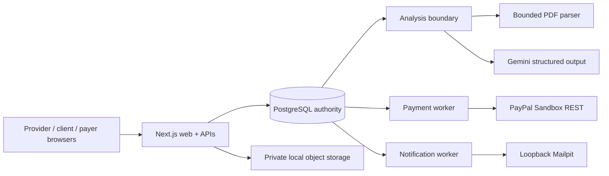

# ScopeLedger

**A human-authorized AI and PayPal workflow for fair, exact scope changes in service work.**

ScopeLedger helps a studio and its client answer a deceptively difficult question:

> When a project changes, what was already promised, what is genuinely new, and what exactly may be approved and paid?

Service projects rarely fail because nobody can write an invoice. They fail because the commercial context is scattered across agreements, amendments, email, prior decisions, and remembered promises. A provider may see additional work. A client may remember that it was included. Both may be acting honestly, yet an ordinary checkout or invoice can turn incomplete context into a surprise charge.

ScopeLedger creates a shared, correctable record before money moves.

## The product in one flow

```text
Request
  -> source-backed AI comparison
  -> provider review
  -> client question or missing-context correction
  -> revised exact terms
  -> explicit version-bound approval
  -> separately authorized PayPal payment
  -> verified readiness
  -> separately recorded work start
```

The AI can investigate, compare, cite, and surface uncertainty. It cannot invent the obligation, set the price, choose the merchant, approve for the client, or authorize payment.

People establish the commercial agreement. PayPal establishes the financial fact. ScopeLedger preserves the relationship between them without collapsing them into an opaque "AI decided" result.

## Why this problem matters

Small studios and their clients often manage scope changes through a mixture of email, memory, spreadsheets, and manual invoices. That creates an information imbalance:

- The provider must recover the original promise while trying to protect delivery time.
- The client may be asked to approve a charge before seeing how prior context was considered.
- Included work can accidentally become hostage to payment for an unrelated extra.
- A browser return or invoice status can be mistaken for agreement, payment, or permission to begin work.
- Later corrections can overwrite the story instead of preserving what each person knew and decided.

ScopeLedger treats a fair outcome as more important than maximizing payment. A successful result may be:

- the work was already included;
- the studio deliberately waives an addition;
- the parties approve one exact paid change;
- the client declines;
- or the request remains held because the evidence is incomplete.

This is the project's practical social impact: reducing surprise charges and informational imbalance while giving both sides a clearer, less adversarial way to repair the premise before money moves.

## The demonstration story

The primary scenario starts with a **USD 450** proposed change:

- a reusable case-study layout;
- and one populated case-study page.

The client supplies missing agreement context showing that the reusable layout was already included. The provider reviews that context instead of treating the AI output as final. ScopeLedger produces a revised **USD 300** version for only the populated page.

The client approves the exact revised version. A separately authorized payer completes PayPal Sandbox Checkout. ScopeLedger verifies the capture server-side and derives `ready`; work start remains a separate, unrecorded fact.

A second custom scenario proves the workflow is not hard-coded:

- the provider creates a new project and request;
- admits a private synthetic source;
- confirms the baseline;
- creates immutable draft revisions;
- prepares USD 200 commercial terms;
- publishes through opaque review locators;
- activates project-scoped client and payer authority;
- records approval;
- and completes a second real PayPal Sandbox capture.

## What makes ScopeLedger different

### 1. Correction is part of the main path

The client is not limited to approve or decline. They can ask a communication-only question or supply missing agreement context. Questions create no commercial hold. Corrections do create a review hold, and a provider response alone cannot silently clear it.

Material corrections flow through a new immutable draft, revised publication, stale-version rejection, and fresh consent.

### 2. AI is useful without becoming the authority

Gemini prepares structured candidate interpretations from permitted source material. The application reconstructs exact source spans locally, keeps supporting and charge-weakening evidence visible, and requires provider review.

Model failure or budget exhaustion leaves an honest parser/manual path. It never produces a success-shaped fallback.

### 3. Payment is linked to one exact obligation

PayPal Checkout is created only after approval of a frozen published version. Browser money fields, Order IDs, capture IDs, merchant identity, and provider status are never trusted.

The return redirect is not financial proof. Capture, discovery, reconciliation, refunds, and reversals use authoritative provider reads and stable operation identity.

### 4. Agreement, payment, readiness, and work start are separate facts

Payment does not prove that work started. Readiness does not prove delivery. A refund or reversal does not rewrite the original capture or invent a new balance.

This separation makes both the interface and the recovery model more honest.

### 5. The record is designed for both sides

The interface attributes consequential facts as:

- provider reviewed;
- client supplied or decided;
- AI candidate;
- or PayPal verified.

The project history and exports preserve questions, corrections, versions, decisions, payments, readiness, known gaps, and work-start observations without turning the record into a dossier against the client.

## Judge walkthrough

The fastest local walkthrough is:

1. Open the provider workspace and create a synthetic project/request.
2. Admit a PDF, text, or Markdown source into private immutable storage.
3. Run source analysis or continue with manual provider review.
4. Confirm the baseline and create an immutable review-ready draft.
5. Prepare treatment, scope, exclusions, rationale, timing, price, and tax.
6. Preview and publish exact terms.
7. Activate the local project approver and follow the opaque client-review URL.
8. Ask a question, submit a correction, or approve/decline the exact version.
9. Activate the exact payer authority for an approved obligation.
10. Complete PayPal Sandbox approval and explicit server-side capture.
11. Review `ready`, work-start separation, project history, notifications, and JSON/HTML exports.

See [JUDGING.md](JUDGING.md) for fresh-clone setup, the judge flow, cleanup, and troubleshooting.

## Technical implementation

ScopeLedger is a TypeScript modular monolith with narrow capability boundaries:



Key implementation choices:

- **Next.js 16 / React / TypeScript** for protected server-rendered workflows.
- **PostgreSQL 17** for immutable versions, authority epochs, ordered-consent fences, durable operations, notifications, drafts, and recovery.
- **Auth0** for provider identity, verified email, encrypted sessions, and MFA assurance.
- **Google Gemini** for bounded, permission-gated candidate analysis.
- **PDF.js in a bounded child process** for isolated text extraction.
- **PayPal Sandbox REST** for real Order approval, capture, retrieval, webhook verification, and financial reconciliation.
- **Mailpit** for local-only participant verification and notification evidence.
- **Content-addressed private object storage** for immutable synthetic source bytes.

The provider, client, model, and browser never receive direct database or payment authority.

## Engineering evidence

The clean pushed repository passes the complete local acceptance profile:

- **52 commands passed**
- **556 tests passed**
- **0 failures**
- **0 skips**
- sequential PostgreSQL migrations **1-9**
- two real PayPal Sandbox approval/capture journeys
- real Auth0 login with OTP MFA
- authenticated Gemini analysis with locally validated evidence
- real Mailpit SMTP capture
- production build, repository typecheck, lint, and isolated browser regression suite

The generated report is written only to ignored `.scopeledger-local/evidence/`.

```sh
npm run judge:doctor
npm run judge:acceptance:quick
npm run judge:acceptance:full
```

The automated acceptance runner intentionally performs no real PayPal write, Auth0 ceremony, Gemini provider call, or external email delivery.

## Run locally

### Requirements

- Node.js `26.0.0`
- npm `11.12.1`
- Docker `27.3.1`
- Chromium for the browser suite

### Prepare

```sh
npm ci
cp .env.example .env.local
```

Add your sandbox-only Auth0, PayPal, and Gemini configuration to ignored `.env.local`, then run:

```sh
npm run judge:prepare
npm run judge:start
```

Start the web application separately:

```sh
npm run dev
```

Open:

- App: <http://127.0.0.1:3000>
- Mailpit: <http://127.0.0.1:8025>

Verify readiness:

```sh
npm run judge:status
npm run judge:doctor
npm run judge:acceptance:quick
```

Stop only the owned local services:

```sh
npm run judge:stop
```

The PostgreSQL volume and private object files are preserved.

## Local operations

```sh
# Deliver durable local notifications.
npm run notifications:process

# Process verified webhook triggers.
npm run paypal:webhooks:process

# Inspect or run the bounded financial audit.
npm run paypal:financial-audit:status
npm run paypal:financial-audit
```

Optional webhook tooling is included for later integration work:

```sh
npm run check:paypal-webhook
npm run paypal:webhook:tunnel
npm run paypal:webhook:manage -- --url https://example.trycloudflare.com/api/paypal/webhook
```

The local judging flow does not require live webhook registration.

## Safety and privacy boundaries

- Sandbox credentials and API keys remain only in ignored `.env.local`.
- Provider identifiers, verification codes, PayPal resource IDs, and private source bytes are excluded from the repository and evidence reports.
- Source URLs are inert references, never permission to fetch arbitrary content.
- Browser returns never prove payment.
- AI output never creates price, consent, payer authority, payment, or readiness.
- Notification delivery never changes commercial state.
- Evaluator upload/analysis/model budgets are enforced from persisted PostgreSQL facts.
- The system uses synthetic documents and identities for judging.

## What this release does not claim

This is a **local, reproducible sandbox application**, not a production financial service.

It does not claim:

- live-money permission;
- production hosting, high availability, or older-backup recovery;
- external transactional-email delivery;
- formal accessibility or WCAG conformance;
- real-world legal enforceability or tax/accounting advice;
- validated market demand or guaranteed revenue recovery;
- actual provider refund/reversal evidence;
- a permanently deployed public webhook.

The refund/reversal reducer, webhook registration tooling, responsive/keyboard checks, and accessibility-oriented implementation remain useful engineering foundations. Formal assistive-technology validation, actual provider refund/reversal exercises, and persistent public webhook operations belong to later release and production-readiness paths, not the local judging requirement.

## Creativity and impact

ScopeLedger combines AI, evidence, human consent, and PayPal in a way that resists the usual pressure to automate the most consequential decision.

The creative move is not asking an AI to decide whether a client owes money. It is giving the AI meaningful investigative work while designing the authority chain so that:

- the client can correct the premise;
- the provider must review the effect;
- changed terms require a new version;
- payment follows exact consent;
- and every fair outcome remains legitimate.

That structure can help small service businesses protect their time without making clients accept unexplained charges. It also gives clients a practical right to repair missing context before payment. The result is a more transparent form of digital commerce, built around shared understanding rather than collection pressure.

## Repository map

```text
apps/web/                       Protected provider, client, payer, and operations UI
packages/contracts/             Canonical published-unit contracts
packages/db/                    PostgreSQL migrations and typed persistence
packages/domain/                Ordered consent, correction, payment, and readiness
packages/analysis/              Evidence, pointer, budget, and coverage validation
packages/adapters/              PayPal, Gemini, parser, email, and object storage
packages/payment-worker/        Dispatch, recovery, webhook, and financial audit
packages/notifications/         Durable local notification delivery
packages/records-export/        Deterministic JSON and accessible HTML records
tests/spikes/                   Sanitized acceptance evidence
scripts/                        Local judging, diagnostics, workers, and provider tooling
```

## License

[MIT](LICENSE)
